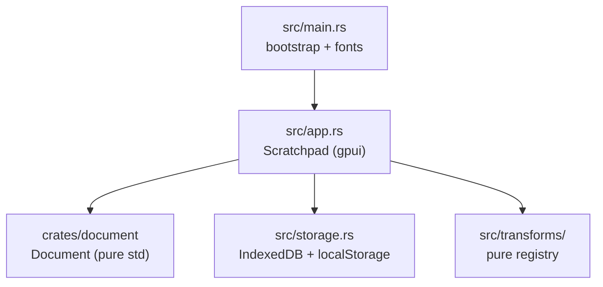

# AGENTS.md

Guidance for contributors and coding agents working on **Zapslab**. Read this
before changing code; it captures the conventions the project follows,
including the split between the pure document model and the gpui view.

## What this is

Zapslab is a WASM/GPUI scratchpad editor, similar in spirit to Boop, shipped as
an installable PWA. A single window hosts a plain-text editor with soft wrap,
selection, undo/redo, a transform palette, and IndexedDB autosave. It targets
documents up to 64 MB: rendering is virtualized (only visible rows are built)
and the pure model keeps an incremental line index so edits do not scan the
whole buffer. It is a small codebase with a deliberately thin, pure core and a
gpui rendering shell.

## Repository layout

```
src/                 root crate `zapslab` (gpui view + platform glue)
  main.rs            bootstrap, window creation, embedded fonts
  app.rs             Scratchpad: rendering, geometry, input, palette, scrollbars
  storage.rs         IndexedDB document + localStorage recent list
                     (wasm-only + non-wasm stub)
  transforms/        pure transform registry (mod.rs + category submodules;
                     each entry has name/tags/scope + fn(&str) -> TransformResult)
crates/document/     standalone crate `zapslab-document` (pure model + tests)
  lib.rs             Document: text, cursor/anchor, undo, UTF-16 mapping, cap
  line_index.rs      incremental per-line byte lengths + Fenwick prefix sums
  grapheme.rs        local grapheme stepping (GraphemeCursor) + full-scan fallback
  display.rs         display-aware wrapping / x mapping (width injectable)
  encoding.rs        text <-> bytes for the hex pane
  hexdump.rs         virtualized hex layout (sparse checkpoint index)
  escape.rs          invisible-character escaping
web/                 static PWA shell: index.html, manifest, sw.js, fonts, icons
scripts/             build_web.sh (wasm-bindgen + wasm-opt packaging), gen_icons.py
docker/Dockerfile    pinned builder image (Rust + wasm32 + wasm-bindgen + binaryen)
Makefile             containerized entry points for every cargo/rust command
dist/                generated web output (gitignored)
.cache/              cargo/home caches and patched wgpu (gitignored)
```

The pure document model lives in `crates/document` (package `zapslab-document`).
Treat that crate as the home for all non-gpui logic described below; the gpui
`Scratchpad` view delegates text, cursor, the incremental line index, UTF-16
mapping, and undo work to it. The document is a flat `String` plus indices (no
rope); the invariants that keep edits off the whole buffer are described below.

## Build, check, test, and serve

All root-crate builds run inside the pinned builder image. The host only needs
`make` and a container runtime (`nerdctl`, `docker`, or `podman`).

```sh
make image       # build the builder image (docker/Dockerfile)
make check       # cargo check --target wasm32-unknown-unknown (fast feedback)
make test        # run the document crate's unit tests (containerized)
make wasm        # release wasm build
make web         # wasm + wasm-bindgen + assets -> dist/
make serve       # build and serve dist/ at http://localhost:8119
make shell       # interactive shell in the builder image
make icons       # regenerate placeholder PWA icons (host python3)
make vendor-wgpu # materialize the patched wgpu source
make clean       # remove target/, dist/, .cache/
```

Rules:

- **Do not run plain `cargo build`/`cargo check` on the host for the root
  package.** The gpui crates are git dependencies pinned to a zed revision, and
  `Cargo.toml` `[patch]`es wgpu to `.cache/wgpu-patched`, which only exists after
  `make vendor-wgpu` (which `make check`/`make wasm`/`make web` depend on).
- The one exception is `crates/document`: its only dependencies are pure-Rust
  Unicode crates (`unicode-segmentation`, `unicode-properties`) with no
  gpui/wasm, so it can be tested directly with
  `cd crates/document && cargo test`. Prefer `make test` for consistency; it runs
  the same tests in the container.
- `make test` covers **only** `crates/document`. The root crate's `#[cfg(test)]`
  code (including `src/transforms/`) is not run by any Makefile target. Type-check
  it inside the builder image with
  `cargo check --tests --target wasm32-unknown-unknown`; to actually run those
  tests, use a standalone crate that path-includes `src/transforms/mod.rs`.
- The `wasm-bindgen` crate pin (`=0.2.127`) and the builder image's
  `wasm-bindgen-cli` must match exactly. The three gpui crates are pinned to one
  zed revision; bump them together.
- The root package has **no `[workspace]` table**; `crates/document` declares its
  own empty `[workspace]`, so it builds and tests independently and is consumed
  by the root package as a path dependency. Do **not** add a root `[workspace]`:
  Cargo would then claim the vendored wgpu crates under `.cache/` as members and
  break their `workspace.package` inheritance.

## Architecture and separation of concerns



### `zapslab-document` — pure model

Owns everything that is text, offsets, or history:

- document text and its **byte-offset** cursor/anchor;
- the **incremental line index** (`line_index.rs`): per-line byte lengths plus a
  Fenwick tree of prefix sums, so `line_of_offset`/`line_range` are O(log lines)
  and a single-line edit is one point update;
- undo/redo as **inverse edits** (per step: the replaced range plus the removed
  and inserted text), bounded by both `MAX_UNDO` steps and `MAX_UNDO_BYTES`;
  memory tracks what the user changed, not the document size;
- UTF-16 ⇄ byte offset conversion with a cached `utf16_len` and nearer-end
  walks, plus free functions for arbitrary strings (e.g. the palette query);
- local grapheme stepping (`grapheme.rs`) using `unicode-segmentation`'s
  `GraphemeCursor`, with the old full scan kept only as a fallback;
- CRLF/CR → `\n` normalization (the model invariant is "no `\r` in `text`");
- the `MAX_DOCUMENT_BYTES` (64 MB) cap and a `revision` counter for view caches.

Rules:

- **No gpui, wasm-bindgen, or web-sys imports.** Keep it `std`-only apart from
  vetted, pure-Rust Unicode crates (currently `unicode-segmentation` and
  `unicode-properties`), so it stays fast to compile and unit-testable without a
  GPU, browser, or network.
- Public API should be pure functions/methods over owned state: `replace`,
  `insert`, `backspace`, `delete_forward`, movement, selection, `undo`/`redo`,
  line queries, UTF-16 mapping. Return results instead of touching a window.
- If a helper needs a glyph advance or a viewport width, it is *not* pure model
  logic; keep the measurement in the view and pass bytes/offsets across.
- **Never reintroduce whole-buffer scans on the editing hot path.** The line
  index, `utf16_len`, and grapheme/UTF-16 stepping are incremental/local for this
  reason. A new line/offset/boundary helper belongs in `line_index.rs` or
  `grapheme.rs` as a local algorithm, with a differential test against a full
  scan.
- **Line semantics are a hard invariant.** Every line but the last ends with
  `\n`, and a trailing `\n` yields a final empty line. `LineIndex` stores byte
  lengths *including* the newline; `apply_edit` recomputes only touched lines and
  decides `final_region` by whether the last touched line is the document's last
  line. Keep `line_count`/`line_of_offset`/`line_range` behavior identical.
- **Keep `utf16_len` in sync** on every mutation (`replace_range`, `restore`,
  `new`); the converters rely on it.

### `zapslab` — gpui view

`Scratchpad` in `src/app.rs` stays responsible for:

- **virtualized rendering**: only rows in (and just around) the viewport are
  materialized, positioned by top/bottom spacers inside a content element with an
  explicit height. `WrapLayout` caches per-line wrap counts as prefix sums, keyed
  by document revision + `(wrap on, invisibles, rounded width)`, rebuilt lazily.
  A `canvas` overlay paints selection/caret in content space;
- geometry: font metrics, glyph advances, soft-wrap row layout, hit-testing,
  caret bounds; **custom horizontal and vertical scrollbars** (gpui draws none
  for overflow containers) with drag support;
- **wrap auto-disable**: past `WRAP_DISABLE_BYTES`/`WRAP_DISABLE_LINES` soft wrap
  is forced off (identity row mapping) and the toggle refuses to re-enable it;
- input routing (`on_key_down`, `EntityInputHandler`), focus, clipboard;
- **size refusal**: refuse input that would exceed `MAX_DOCUMENT_BYTES` before
  mutating (`Attempted paste was too large.` for an oversized paste, a generic
  limit message otherwise);
- **expensive-transform confirmation**: `transforms::is_expensive` plus a 2 MB
  input threshold opens a modal instead of blocking the UI;
- **hex pane**: a virtualized `HexIndex` (only visible rows are materialized,
  carried by spacers) cached by `(document revision, encoding, bytes_per_row)`;
  hit-testing maps encoded byte offsets back to text through the same index. It
  owns its own scroll handle (`hex_scroll`) and a **custom vertical scrollbar**
  with drag support, mirroring the editor's geometry helpers
  (`hex_scroll_geometry`, `begin_hex_v_drag`, `update_hex_v_drag`);
- async work (caret blink, IndexedDB load/save) and any debouncing timers;
- presentation-only state (palette UI, scroll handles, drag state).

`src/main.rs` only bootstraps: install the panic hook, register the embedded
fonts, and open the window. `expect` is acceptable there for unrecoverable
startup failures (fonts/window); avoid panics on the input hot path.

### Storage

`src/storage.rs` persists the document in **IndexedDB** (localStorage's
~5–10 MB quota cannot hold a 64 MB document). It is
`#[cfg(target_arch = "wasm32")]` with a non-wasm stub that returns immediately;
keep the public signatures identical across both.

- **Document text → IndexedDB**: database `zapslab`, object store `documents`,
  key `text.v1`. **Recent transforms → localStorage** (`zapslab.recent.v1`,
  small and synchronous).
- `load`/`save` are **async** on both targets. IndexedDB requests are bridged to
  Rust futures with `wasm-bindgen-futures`; the wasm-only deps are `js-sys` and
  `wasm-bindgen-futures`, and `web-sys` enables the `Idb*` features.
- **One-time migration**: if IndexedDB is empty, the legacy localStorage
  `zapslab.text.v1` value is copied in and the old key removed *only after a
  successful write*. Keys stay versioned (old versions ignored, not migrated).
- `save` is **fallible** and callers surface failures (status bar); do not
  silently discard a failed save.
- Writes are debounced (500 ms; 2 s above 4 MB, where copying/writing is
  expensive). Copy the text only after the debounce fires, never on every
  keystroke, and never block typing on storage.

## Coding principles and patterns

- **Keep logic pure and unit-testable.** Extract pure helpers instead of burying
  them in the view. If it can be a function over `(&str, offsets)`, it belongs in
  `zapslab-document`.
- **Name constants instead of using magic numbers.** Follow the existing
  `FONT_SIZE`, `PAD`, `CARET_WIDTH`, `MAX_UNDO`, `STATUS_BAR_HEIGHT`,
  `SCROLLBAR_*`, `MIN_THUMB_WIDTH` style.
- **Comment the *why*, not the *what*.** Document invariants and non-obvious
  tradeoffs, as in the existing comments about caret-task lifetime, CRLF
  normalization on paste, scrollbar geometry, wrap-boundary resolution, and the
  wgpu zero-buffer patch.
- **Never swallow errors that affect the user.** A failed autosave must reach the
  user. `let _ = op()` is only acceptable where failure is genuinely irrelevant
  (and should be commented).
- **Undo stores inverse edits, not document snapshots.** Each step records the
  replaced range plus the removed and inserted text, so memory tracks what the
  user changed, not the document size. Keep the ring (`VecDeque`) O(1) at the
  ends, enforce both `MAX_UNDO` and `MAX_UNDO_BYTES`, coalesce contiguous typing
  runs into one step, and preserve the public `undo`/`redo` semantics
  (coalescing, skipping no-op edits, cursor/anchor restore). A new edit clears
  redo; undo/redo move steps between the two stacks.
- **Throttle expensive synchronous side effects** on the hot path. IndexedDB
  writes are debounced and async; copy the document only after the debounce, and
  never block typing on storage.
- **Document is a flat `String`, not a rope.** Mid-buffer edits pay a memmove and
  line-count-changing edits re-splice the length vector (O(lines)), but the hot
  path never rescans the text. Do not add a rope without a project-wide decision.
- **Virtualization invariants.** Uniform row height; only visible rows are built;
  the content element carries an explicit total height with top/bottom spacers;
  the overlay paints in content space so caret/selection align with the rows. The
  `WrapLayout` cache must invalidate on document `revision` and on wrap settings.
- **Refuse over-limit input before mutating.** Check `MAX_DOCUMENT_BYTES` in the
  view and again in the model. An oversized paste gets the dedicated message;
  other overflows get the generic limit message.
- **Keep the expensive-transform list current.** `transforms::is_expensive` is a
  name list; add any new sort/parser/formatter/shuffle so the confirmation modal
  covers it.
- **Use `#[cfg(target_arch = "wasm32")]` with a non-wasm stub** for platform
  code and keep public signatures uniform, so callers compile on both targets.
- **UTF-16 is the platform boundary.** `EntityInputHandler` speaks UTF-16; the
  model works in byte offsets. For document offsets use the `Document` methods
  (`utf16_offset` / `byte_offset_for_utf16`), which walk from the nearer end
  using the cached `utf16_len`; the free functions of the same name are for
  arbitrary strings (e.g. the palette query). Always respect
  `str::is_char_boundary` when clamping or stepping.
- **Keep CRLF normalization centralized** at document boundaries (load and
  insert/replace), so line and wrap math can assume `\n` only.
- **Keep comments and attributes accurate.** Delete stale milestone notes
  ("M0", "wired up in M2") and `#[allow(dead_code)]`/`#[allow(unused_imports)]`
  once the code is actually used. A stale allow hides real regressions.
- **Match the existing style.** rustfmt defaults (4-space indent, trailing
  commas, standard import grouping); tabs in `Makefile`, `Dockerfile`, and shell
  scripts. Don't reformat unrelated code in a focused change.
- **Guard invariants explicitly.** Prefer early returns and `Option`/`Result`
  over `expect`. If a panic is truly unreachable, comment why it is an invariant.

## Testing guidelines

- Put pure model tests in `crates/document` (inline `#[cfg(test)] mod tests`).
  They must run without a GPU, browser, or network.
- Treat these as high-risk and test them:
  - UTF-16 ⇄ byte mapping, especially astral characters (surrogate pairs/emoji)
    and positions inside a multi-byte character;
  - the line model (`LineIndex`): `line_of_offset`, `line_start`, `line_range`
    (excluding the trailing newline), empty lines, trailing newline,
    end-of-document, and incremental `apply_edit` vs. a from-scratch rebuild
    (exhaustive + seeded fuzz);
  - local grapheme stepping, UTF-16 conversion, and `word_range_at`: differential
    tests against full-scan references over a Unicode corpus at every offset;
  - undo/redo: inverse-edit correctness (deletions, multi-line and selection
    replacements), coalescing, no-op skipping, bounded count/bytes, and restore
    of text + cursor + anchor;
  - CRLF/CR normalization on load and on insert/paste;
  - wrapping: row splitting and offset↔row↔x mapping. Keep glyph measurement
    injectable (a width function) so wrapping math can be tested without gpui.
- Test behavior, not implementation details. Add a regression test for every bug
  fix in the model.
- `src/transforms/` tests are fine to keep alongside the pure registry; run
  them through the containerized target, not host cargo for the root crate.
  Because the root crate pulls in gpui, the pure transform tests are easiest to
  run via a small standalone crate that path-includes `src/transforms/mod.rs`.

## Definition of done

- [ ] `make check` compiles cleanly for `wasm32-unknown-unknown`.
- [ ] `make test` passes, and new pure logic has unit tests in `crates/document`.
- [ ] Hot-path edits do not scan the whole buffer (line index / grapheme / UTF-16
      stay incremental or local).
- [ ] Input that would exceed `MAX_DOCUMENT_BYTES` is refused before mutating.
- [ ] Pure logic lives in `crates/document`; no gpui/wasm imports there.
- [ ] Public signatures stay uniform across wasm and non-wasm builds.
- [ ] Errors that affect the user are surfaced (especially autosave).
- [ ] Constants are named; invariants are documented with *why* comments.
- [ ] Stale milestones, `#[allow(...)]`, and misleading comments are removed.
- [ ] Formatting matches rustfmt defaults and the surrounding code.
- [ ] New pure-logic dependencies in `crates/document` are vetted Unicode crates
      (no gpui/wasm) and pinned to the versions available in the build cache.

## Current status and known limitations

- **Redo leaves a plain caret.** Undo restores the exact pre-edit selection, but
  redo places the caret at the end of the re-inserted text (caret == anchor)
  rather than re-selecting a transform's output.
- **Hex index rebuild is O(text).** The hex pane's sparse checkpoint index is
  rebuilt when the document revision, encoding, or row width changes — i.e. on
  each edit while the panel is open and while dragging the divider. Rendering is
  virtualized, so only visible rows are materialized per frame, but the index
  build is whole-buffer. Byte and encoding edits still encode/decode the whole
  buffer (an explicit, user-initiated transformation).
- **Wrap-on layout rebuild is O(lines log n)** and only runs for documents below
  the auto-disable thresholds; large buffers use wrap-off with O(1) row mapping.
- **Pixel geometry is `f32`.** Very high row counts (tens of millions) can lose
  scroll precision; typical 64 MB text is well within limits.

## When to ask

Raise decisions with product or UX tradeoffs with the user instead of guessing.
Examples: the 64 MB cap and refusal wording, autosave debounce and failure UI,
undo-history strategy (snapshot vs. delta), wrap auto-disable thresholds and
scrollbar behavior, palette interaction and keybindings, and whether a transform
should preserve or replace selection. Implement the mechanical part; ask before
locking in a user-visible behavior change.
