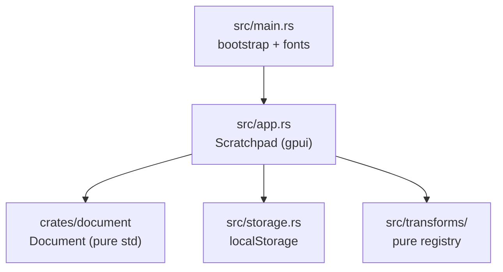

# AGENTS.md

Guidance for contributors and coding agents working on **Zapslab**. Read this
before changing code; it captures the conventions the project follows,
including the split between the pure document model and the gpui view.

## What this is

Zapslab is a WASM/GPUI scratchpad editor, similar in spirit to Boop, shipped as
an installable PWA. A single window hosts a plain-text editor with soft wrap,
selection, undo/redo, a transform palette, and localStorage autosave. It is a
small codebase with a deliberately thin, pure core and a gpui rendering shell.

## Repository layout

```
src/                 root crate `zapslab` (gpui view + platform glue)
  main.rs            bootstrap, window creation, embedded fonts
  app.rs             Scratchpad: rendering, geometry, input, palette, scrollbar
  storage.rs         localStorage autosave (wasm-only + non-wasm stub)
  transforms/        pure transform registry (mod.rs + category submodules;
                     each entry has name/tags/scope + fn(&str) -> TransformResult)
crates/document/     standalone crate `zapslab-document` (pure model + tests)
web/                 static PWA shell: index.html, manifest, sw.js, fonts, icons
scripts/             build_web.sh (wasm-bindgen + wasm-opt packaging), gen_icons.py
docker/Dockerfile    pinned builder image (Rust + wasm32 + wasm-bindgen + binaryen)
Makefile             containerized entry points for every cargo/rust command
dist/                generated web output (gitignored)
.cache/              cargo/home caches and patched wgpu (gitignored)
```

The pure document model lives in `crates/document` (package `zapslab-document`).
Treat that crate as the home for all non-gpui logic described below; the gpui
`Scratchpad` view delegates text, cursor, line-index, and undo work to it.

## Build, check, test, and serve

All root-crate builds run inside the pinned builder image. The host only needs
`make` and a container runtime (`nerdctl`, `docker`, or `podman`).

```sh
make image       # build the builder image (docker/Dockerfile)
make check       # cargo check --target wasm32-unknown-unknown (fast feedback)
make test        # run the document crate's unit tests (containerized)
make wasm        # release wasm build
make web         # wasm + wasm-bindgen + assets -> dist/
make serve       # build and serve dist/ at http://localhost:8119
make shell       # interactive shell in the builder image
make icons       # regenerate placeholder PWA icons (host python3)
make vendor-wgpu # materialize the patched wgpu source
make clean       # remove target/, dist/, .cache/
```

Rules:

- **Do not run plain `cargo build`/`cargo check` on the host for the root
  package.** The gpui crates are git dependencies pinned to a zed revision, and
  `Cargo.toml` `[patch]`es wgpu to `.cache/wgpu-patched`, which only exists after
  `make vendor-wgpu` (which `make check`/`make wasm`/`make web` depend on).
- The one exception is `crates/document`: its only dependencies are pure-Rust
  Unicode crates (`unicode-segmentation`, `unicode-properties`) with no
  gpui/wasm, so it can be tested directly with
  `cd crates/document && cargo test`. Prefer `make test` for consistency; it runs
  the same tests in the container.
- The `wasm-bindgen` crate pin (`=0.2.127`) and the builder image's
  `wasm-bindgen-cli` must match exactly. The three gpui crates are pinned to one
  zed revision; bump them together.
- The root package has **no `[workspace]` table**; `crates/document` declares its
  own empty `[workspace]`, so it builds and tests independently and is consumed
  by the root package as a path dependency. Do **not** add a root `[workspace]`:
  Cargo would then claim the vendored wgpu crates under `.cache/` as members and
  break their `workspace.package` inheritance.

## Architecture and separation of concerns



### `zapslab-document` — pure model

Owns everything that is text, offsets, or history:

- document text and its **byte-offset** cursor/anchor;
- the line-start index and line/offset queries;
- undo/redo snapshots with a bounded history;
- UTF-16 ⇄ byte offset conversion for the platform input handler;
- CRLF/CR → `\n` normalization (the model invariant is "no `\r` in `text`").

Rules:

- **No gpui, wasm-bindgen, or web-sys imports.** Keep it `std`-only apart from
  vetted, pure-Rust Unicode crates (currently `unicode-segmentation` and
  `unicode-properties`), so it stays fast to compile and unit-testable without a
  GPU, browser, or network.
- Public API should be pure functions/methods over owned state: `replace`,
  `insert`, `backspace`, `delete_forward`, movement, selection, `undo`/`redo`,
  line queries, UTF-16 mapping. Return results instead of touching a window.
- If a helper needs a glyph advance or a viewport width, it is *not* pure model
  logic; keep the measurement in the view and pass bytes/offsets across.

### `zapslab` — gpui view

`Scratchpad` in `src/app.rs` stays responsible for:

- rendering (`div` per visual row, `canvas` overlay for caret/selection);
- geometry: font metrics, glyph advances, soft-wrap row layout, hit-testing,
  caret bounds, scrollbar layout and drag;
- input routing (`on_key_down`, `EntityInputHandler`), focus, clipboard;
- async work (the caret blink task) and any debouncing timers;
- presentation-only state (palette UI, scroll handles, drag state).

`src/main.rs` only bootstraps: install the panic hook, register the embedded
fonts, and open the window. `expect` is acceptable there for unrecoverable
startup failures (fonts/window); avoid panics on the input hot path.

### Storage

`src/storage.rs` is localStorage autosave for the browser. It is
`#[cfg(target_arch = "wasm32")]` with a no-op non-wasm stub so native builds and
tests still compile; keep the public signatures identical across both.

- Keys are versioned (`zapslab.text.v1`): an old version is ignored and
  overwritten, not migrated.
- `save` is **fallible** and callers must surface failures (e.g. a status-bar
  message). Do not silently discard a failed save.
- localStorage writes happen on the editing hot path; debounce/throttle them
  rather than writing synchronously on every keystroke.

## Coding principles and patterns

- **Keep logic pure and unit-testable.** Extract pure helpers instead of burying
  them in the view. If it can be a function over `(&str, offsets)`, it belongs in
  `zapslab-document`.
- **Name constants instead of using magic numbers.** Follow the existing
  `FONT_SIZE`, `PAD`, `CARET_WIDTH`, `MAX_UNDO`, `STATUS_BAR_HEIGHT`,
  `SCROLLBAR_*`, `MIN_THUMB_WIDTH` style.
- **Comment the *why*, not the *what*.** Document invariants and non-obvious
  tradeoffs, as in the existing comments about caret-task lifetime, CRLF
  normalization on paste, scrollbar geometry, wrap-boundary resolution, and the
  wgpu zero-buffer patch.
- **Never swallow errors that affect the user.** A failed autosave must reach the
  user. `let _ = op()` is only acceptable where failure is genuinely irrelevant
  (and should be commented).
- **Bound history with a ring buffer.** Undo/redo stay O(1) at the ends via
  `VecDeque` (`push_back`/`pop_front`) in `zapslab-document`, enforcing
  `MAX_UNDO`. Do not reintroduce `Vec::remove(0)` on the hot path. Preserve the
  behavior of not pushing duplicate snapshots, and keep contiguous typing runs
  coalesced into a single undo step.
- **Throttle expensive synchronous side effects** on the hot path. localStorage
  writes should be coalesced/debounced; do not block typing on storage.
- **Use `#[cfg(target_arch = "wasm32")]` with a non-wasm stub** for platform
  code and keep public signatures uniform, so callers compile on both targets.
- **UTF-16 is the platform boundary.** `EntityInputHandler` speaks UTF-16; the
  model works in byte offsets. Convert only at the edges
  (`utf16_offset` / `byte_offset_for_utf16`) and always respect
  `str::is_char_boundary` when clamping or stepping.
- **Keep CRLF normalization centralized** at document boundaries (load and
  insert/replace), so line and wrap math can assume `\n` only.
- **Keep comments and attributes accurate.** Delete stale milestone notes
  ("M0", "wired up in M2") and `#[allow(dead_code)]`/`#[allow(unused_imports)]`
  once the code is actually used. A stale allow hides real regressions.
- **Match the existing style.** rustfmt defaults (4-space indent, trailing
  commas, standard import grouping); tabs in `Makefile`, `Dockerfile`, and shell
  scripts. Don't reformat unrelated code in a focused change.
- **Guard invariants explicitly.** Prefer early returns and `Option`/`Result`
  over `expect`. If a panic is truly unreachable, comment why it is an invariant.

## Testing guidelines

- Put pure model tests in `crates/document` (inline `#[cfg(test)] mod tests`).
  They must run without a GPU, browser, or network.
- Treat these as high-risk and test them:
  - UTF-16 ⇄ byte mapping, especially astral characters (surrogate pairs/emoji)
    and positions inside a multi-byte character;
  - the line model: `line_starts`, `line_of_offset`, `line_range` (excluding the
    trailing newline), empty lines, trailing newline, end-of-document;
  - undo/redo: push/dedupe, bounded history, restore of text + cursor + anchor;
  - CRLF/CR normalization on load and on insert/paste;
  - wrapping: row splitting and offset↔row↔x mapping. Keep glyph measurement
    injectable (a width function) so wrapping math can be tested without gpui.
- Test behavior, not implementation details. Add a regression test for every bug
  fix in the model.
- `src/transforms/` tests are fine to keep alongside the pure registry; run
  them through the containerized target, not host cargo for the root crate.
  Because the root crate pulls in gpui, the pure transform tests are easiest to
  run via a small standalone crate that path-includes `src/transforms/mod.rs`.

## Definition of done

- [ ] `make check` compiles cleanly for `wasm32-unknown-unknown`.
- [ ] `make test` passes, and new pure logic has unit tests in `crates/document`.
- [ ] Pure logic lives in `crates/document`; no gpui/wasm imports there.
- [ ] Public signatures stay uniform across wasm and non-wasm builds.
- [ ] Errors that affect the user are surfaced (especially autosave).
- [ ] Constants are named; invariants are documented with *why* comments.
- [ ] Stale milestones, `#[allow(...)]`, and misleading comments are removed.
- [ ] Formatting matches rustfmt defaults and the surrounding code.
- [ ] New pure-logic dependencies in `crates/document` are vetted Unicode crates
      (no gpui/wasm) and pinned to the versions available in the build cache.

## When to ask

Raise decisions with product or UX tradeoffs with the user instead of guessing.
Examples: autosave debounce interval and failure UI, undo-history size and
grouping, wrap/scrollbar behavior, palette interaction and keybindings, and
whether a transform should preserve or replace selection. Implement the
mechanical part; ask before locking in a user-visible behavior change.
